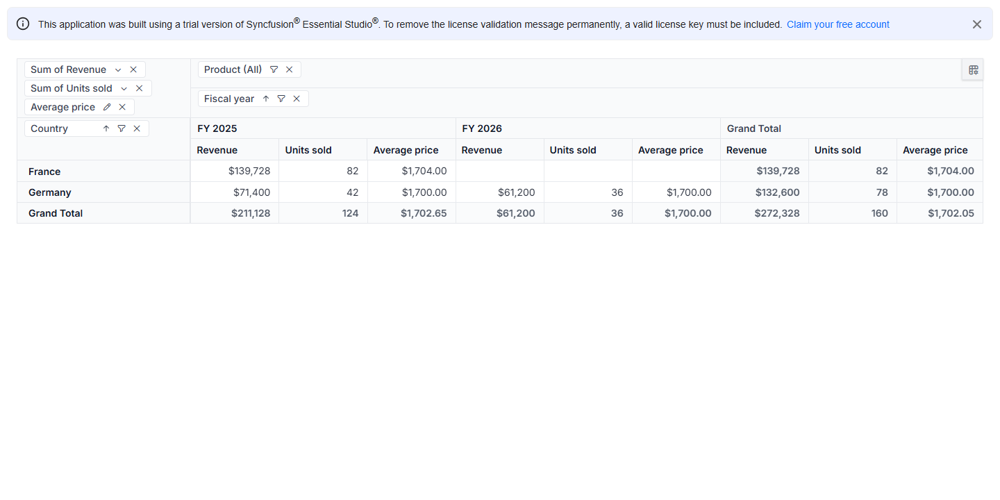
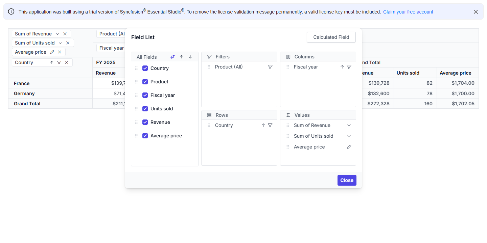
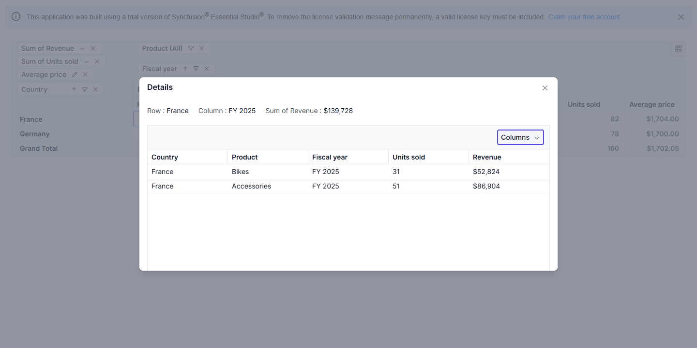

# React Pivot Table feature evaluation sample

Companion to "20 Syncfusion React Pivot Table Features for Real Reporting Apps".

## Run

From this folder, run `npm ci` then `npm run dev`. Open the local URL Vite prints. Run `npm run build` for a production build. Keep package-lock.json for reproducible installs.

Copy .env.example to .env.local and set VITE_SYNCFUSION_LICENSE_KEY to register your own key. Without a key, the trial notice is expected. No license credentials are distributed with this sample. Vite environment values are public browser configuration.

## Verified environment

- Date: November 24, 2026
- Windows; Node.js 24.16.0; npm 11.13.0
- Syncfusion PivotView, base, and Tailwind 3 theme: 35.2.12
- React / React DOM: 19.3.1; Vite: 8.3.8
- Playwright: 1.65.1; installed Chrome: 158.0.8127.37

## Verification

Production build passed (with a large-chunk warning). Functional checks confirmed France revenue 139,728, units 82, average price 1,704.00; overall revenue 272,328, units 160, and rounded average price 1,702.05. Field List and calculated-field dialogs opened; a pointer drag toward Columns left Revenue in Values; drill-through showed the two contributing France records. No uncaught browser JavaScript errors occurred. See verification.json.

To repeat browser checks, install Google Chrome, start `npm run dev -- --port 5173`, and run `node verify.mjs` from this folder. Screenshots are written to the sample-local `artifacts/` folder. The `assets/` folder contains screenshots from the original verification run. Checks use synthetic in-memory data and do not validate all 20 article features, OLAP, server processing, security, accessibility, or performance. The optional formatting extension in the article is documentation-derived and outside these browser checks.

## Data boundaries

The four records contain country, product, fiscal-year label, units (sold), and revenue (amount). Currency formatting uses the default locale. The data includes an empty France/FY 2026 intersection, which rendered blank. No backend, authentication, or durable storage is implemented. Do not put restricted source records into this client-side demo.

## Screenshots

## Related resources

- [React Pivot Table documentation](https://ej2.syncfusion.com/react/documentation/pivotview/getting-started)
- [React Pivot Table demos](https://ej2.syncfusion.com/react/demos/#/bootstrap5/pivot-table/overview)
